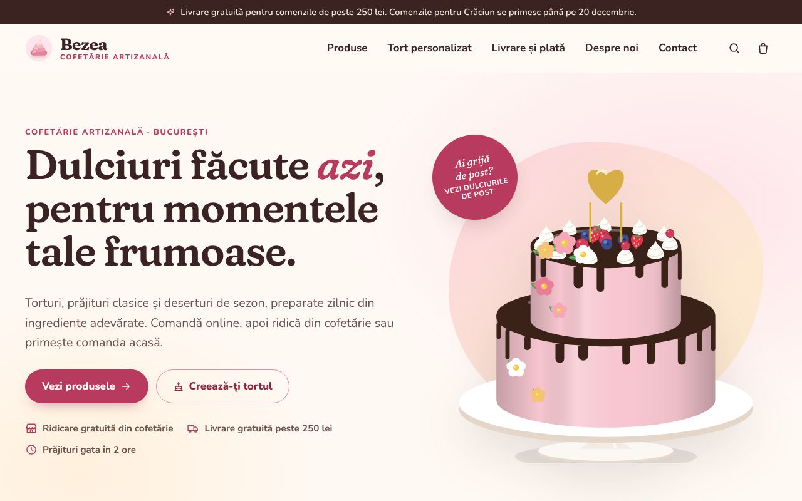
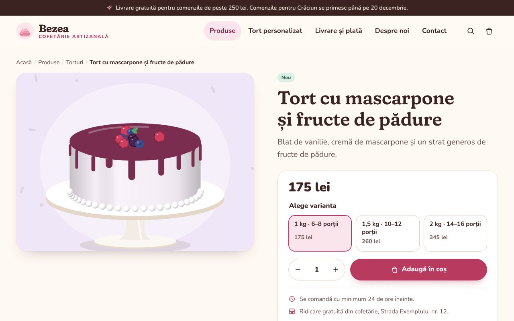
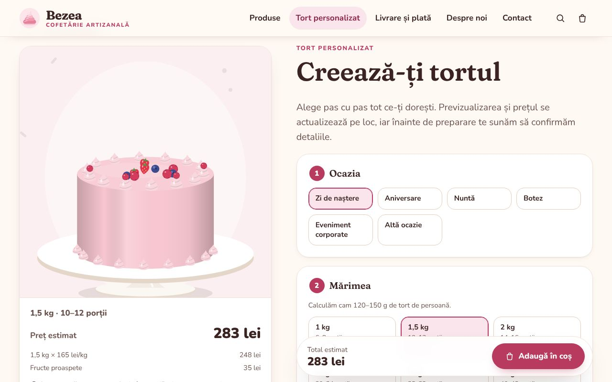
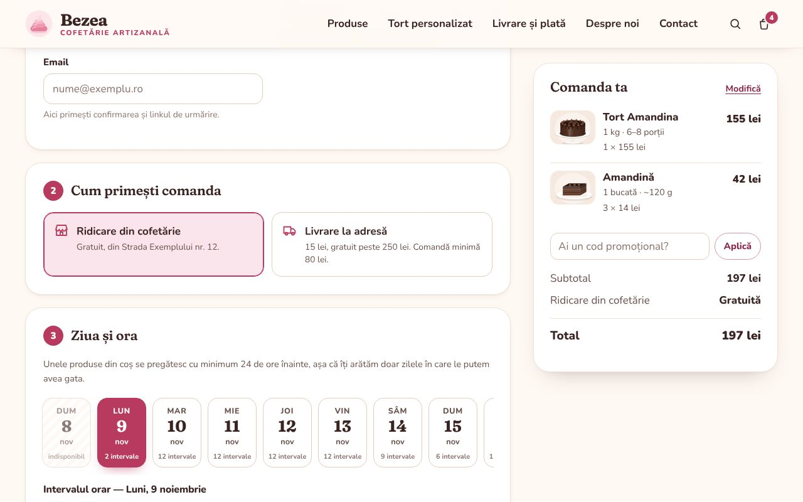
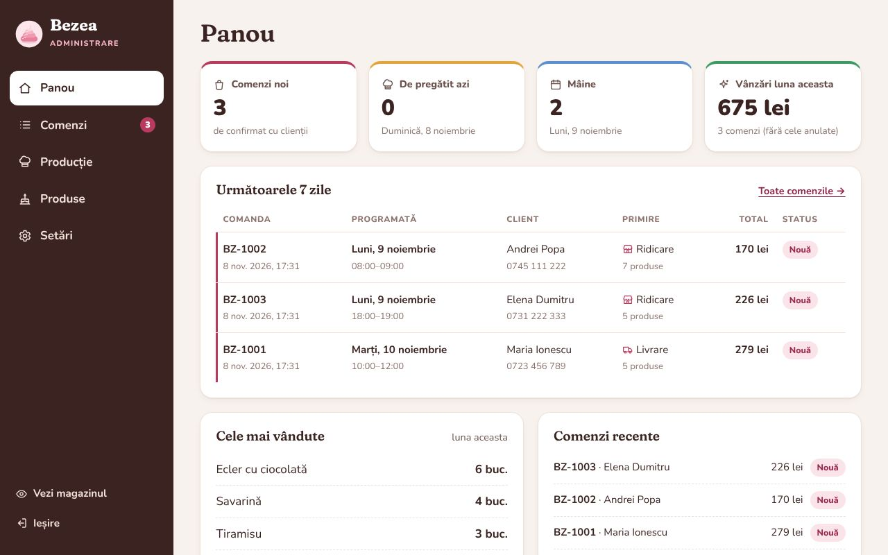

# Cofetăria Bezea — magazin online

Un magazin online complet pentru o cofetărie: catalog de produse, coș de cumpărături, comenzi cu programare pe zi și interval orar, configurator de tort personalizat cu previzualizare live și un panou de administrare pentru comenzi, producție, produse și setări.

Totul este în limba română, cu prețuri în lei, fusul orar al României și informațiile obligatorii pentru un magazin online din România (alergeni, date de identificare ale firmei, ANPC, termeni și confidențialitate).



> „Bezea” este un nume de exemplu. Numele, adresa, telefonul și datele firmei se schimbă dintr-un singur fișier — vezi [Personalizare](#personalizare).

## Ce conține

**Pentru clienți**

- **Catalog** cu 6 categorii și 41 de produse de exemplu (torturi, prăjituri, deserturi la pahar, fursecuri, macarons și mignon, cozonaci), cu căutare fără diacritice, filtre („De post”, „Fără gluten”, „Nou”, „De sezon”) și sortare.
- **Pagină de produs** cu variante (de exemplu 1 kg / 1,5 kg / 2 kg), ingrediente, **alergeni** și condiții de păstrare.
- **Tort personalizat**: clientul alege mărimea (1–6 kg, până la trei etaje), blatul, crema, umplutura, finisajul, culoarea, decorul, extra-opțiunile și mesajul de pe tort. Previzualizarea și prețul se actualizează pe loc.
- **Coș** cu sertar lateral, modificarea cantităților, anularea ștergerii, cod promoțional și indicator „mai adaugă X lei pentru livrare gratuită”.
- **Finalizarea comenzii**: ridicare din cofetărie sau livrare, alegerea zilei și a intervalului orar (doar intervalele în care produsele pot fi gata, în funcție de timpul lor de pregătire și de program), plată numerar, card la primire sau transfer bancar.
- **Pagina comenzii** cu stadiul ei (primită → confirmată → în preparare → gata → livrată/ridicată), accesibilă printr-un link personal, plus „Urmărește comanda” după număr și telefon.
- Pagini de informații: livrare și plată, întrebări frecvente, despre noi, contact, termeni și condiții, politica de confidențialitate.

**Pentru cofetărie (`/admin`)**

- **Panou**: comenzi noi, ce e de pregătit azi și mâine, vânzările lunii, cele mai vândute produse. Se actualizează singur la fiecare minut.
- **Comenzi**: filtrare după status, dată și căutare; detaliile comenzii, schimbarea statusului cu un clic (cu email opțional către client), istoric, notă internă, tipărire și **export CSV** (se deschide direct în Excel).
- **Producție**: pentru orice zi, lista cumulată a produselor de preparat, torturile personalizate cu toate detaliile și comenzile programate pe intervale — gata de tipărit pentru laborator.
- **Produse**: adăugare, editare, ascundere și ștergere; variante și prețuri; alergeni și etichete; timp minim de pregătire; **încărcare de fotografii** (redimensionate automat în browser).
- **Setări**: oprirea temporară a comenzilor online, anunțul din partea de sus a site-ului, taxa de livrare, pragul de livrare gratuită, comanda minimă, zilele în care sunteți închiși și **coduri promoționale** (procent sau sumă fixă, prag minim, dată de expirare, număr maxim de utilizări).

| | |
|---|---|
|  |  |
|  |  |

## Pornire rapidă

Ai nevoie de **Node.js 22.13 sau mai nou** (versiunea LTS de pe [nodejs.org](https://nodejs.org)). Baza de date este SQLite, inclusă în Node.js — nu trebuie instalat nimic altceva.

```bash
npm install
npm start
```

Deschide <http://localhost:3000>. Panoul de administrare este la <http://localhost:3000/admin>; la prima pornire, parola este generată automat, afișată în terminal și salvată în `data/admin-password.txt` (o poți alege tu cu variabila `ADMIN_PASSWORD`).

Pentru dezvoltare, `npm run dev` repornește serverul la fiecare modificare.

Codul promoțional de exemplu este **BUNVENIT10** (10% reducere la comenzi de peste 100 lei); îl poți dezactiva din Setări.

## Personalizare

| Ce vrei să schimbi | Unde |
|---|---|
| Numele cofetăriei, adresa, telefonul, emailul, datele firmei (CUI, Reg. Com., IBAN), programul, zona de livrare | `src/config.js` → `shop` |
| Durata intervalelor de ridicare/livrare, ora de început a livrărilor, câte zile în avans se poate comanda | `src/config.js` → `ordering` |
| Metodele de plată, statusurile comenzilor, alergenii, etichetele | `src/config.js` |
| Taxa de livrare, livrarea gratuită, comanda minimă, zilele închise, anunțul, oprirea comenzilor, codurile promoționale | panoul de administrare → **Setări** |
| Produsele, prețurile, fotografiile | panoul de administrare → **Produse** |
| Opțiunile și prețurile tortului personalizat | `public/js/shared/custom-cake.js` |
| Culorile și fonturile | `public/css/style.css` (variabilele de la început) |
| Textele legale | `src/views/pages.js` |

Catalogul inițial (`src/data/catalog.js`) este încărcat o singură dată, la prima pornire. După aceea, produsele se administrează din panou. Ca să o iei de la capăt cu catalogul inițial: `npm run db:reset -- --da` (șterge **toate** comenzile și modificările).

### Imaginile produselor

Fiecare produs are o ilustrație generată automat, ca site-ul să arate bine din prima zi. Când încarci o fotografie din panou (Produse → produsul → Imagine), aceasta înlocuiește ilustrația. Fotografiile sunt redimensionate în browser la maximum 1600 px și salvate în `data/uploads/`. Pentru produsele fără fotografie, ilustrația se poate ajusta din „Ilustrație (avansat)”.

### Emailuri

Fără configurare, comenzile apar în panoul de administrare, iar emailurile doar se afișează în terminal. Pentru a trimite confirmări clienților și o notificare pentru fiecare comandă nouă, completează variabilele `SMTP_*` din `.env` (vezi `.env.example`). Funcționează cu orice server SMTP (Gmail/Google Workspace, Microsoft 365, furnizorul de găzduire etc.).

## Configurare prin variabile de mediu

Copiază `.env.example` ca `.env`. Cele mai importante:

| Variabilă | Rol |
|---|---|
| `PORT` | portul serverului (implicit 3000) |
| `SITE_URL` | adresa publică, de exemplu `https://www.cofetaria-ta.ro` |
| `ADMIN_PASSWORD` | parola panoului de administrare |
| `DATA_DIR` | dosarul cu baza de date și fotografiile (implicit `./data`) |
| `TRUST_PROXY` | `1` când site-ul rulează în spatele unui proxy (nginx, Caddy, platforme de găzduire) |
| `ALLOW_EMBED` | `1` ca site-ul să poată fi afișat într-un cadru (iframe), de exemplu într-un panou de previzualizare; implicit interzis |
| `SMTP_HOST`, `SMTP_PORT`, `SMTP_SECURE`, `SMTP_USER`, `SMTP_PASS`, `MAIL_FROM`, `SHOP_NOTIFY_EMAIL` | trimiterea emailurilor |

## Publicare online

Aplicația este un singur proces Node.js, deci rulează pe orice VPS sau platformă care suportă Node.js ori Docker.

**Cu Docker:**

```bash
docker build -t cofetarie .
docker run -d --name cofetarie -p 3000:3000 -v cofetarie-date:/data \
  -e ADMIN_PASSWORD='o-parola-lunga' -e SITE_URL='https://www.cofetaria-ta.ro' -e TRUST_PROXY=1 cofetarie
```

Recomandări pentru producție:

- Pune în față un server cu **HTTPS** (de exemplu [Caddy](https://caddyserver.com), care obține automat certificatul) și setează `TRUST_PROXY=1`. Cu `NODE_ENV=production`, cookie-ul de administrare circulă doar prin HTTPS.
- Fă **copii de siguranță** ale dosarului de date (`data/` sau volumul `/data`): conține baza de date `cofetarie.db` și fotografiile.
- Setează `SITE_URL`, ca linkurile din emailuri și din sitemap să fie corecte.

## Securitate și confidențialitate

- Prețurile și totalurile sunt recalculate mereu pe server; browserul trimite doar produsele și cantitățile.
- Panoul de administrare: parolă, cookie semnat și `HttpOnly`, protecție CSRF pe toate formularele, limitarea încercărilor de autentificare.
- Formularul de comandă are protecție anti-spam (câmp capcană și limitarea numărului de comenzi), iar paginile comenzilor sunt accesibile doar prin link personal.
- Antete de securitate (Content-Security-Policy etc.); fotografiile încărcate sunt verificate după conținut, nu după extensie.
- Site-ul nu folosește cookie-uri de urmărire și nu încarcă resurse de la terți (fonturile sunt găzduite local).

## Plăți online cu cardul

Momentan clienții plătesc numerar sau cu cardul la primire, ori prin transfer bancar. Pentru plata online se poate integra un procesator de plăți (de exemplu Netopia, EuPlătesc sau Stripe): după crearea comenzii, clientul este trimis la pagina de plată, iar confirmarea procesatorului actualizează comanda.

## Texte legale

Paginile „Termeni și condiții” și „Politica de confidențialitate” sunt **modele**: completează-le cu datele firmei și verifică-le cu un specialist înainte de lansare. Datele de identificare ale firmei apar în subsolul fiecărei pagini, alături de linkurile către ANPC și SAL.

## Teste

```bash
npm test
```

Testele verifică formatarea, programarea (inclusiv schimbarea orei de vară), calculul prețurilor și al reducerilor, API-ul de comenzi și panoul de administrare.

## Structura proiectului

```
server.js                 pornește serverul
src/
  app.js                  aplicația Express
  config.js               datele cofetăriei și regulile de comandă
  db.js                   baza de date SQLite (tabele și interogări)
  data/catalog.js         catalogul inițial de produse
  lib/                    prețuri, programare, comenzi, securitate, emailuri
  routes/                 rutele publice, API-ul și panoul de administrare
  views/                  paginile HTML
public/
  css/                    stilurile magazinului și ale panoului
  js/                     coșul, finalizarea comenzii, configuratorul de tort
  js/shared/              cod comun server–browser (ilustrații, prețuri tort, formatări)
  fonts/, img/            fonturi (licență SIL OFL) și imagini
test/                     teste automate (node:test)
```

## Licențe

Fonturile Fraunces și Nunito sunt distribuite sub licența SIL Open Font License 1.1 (vezi `public/fonts/`).
